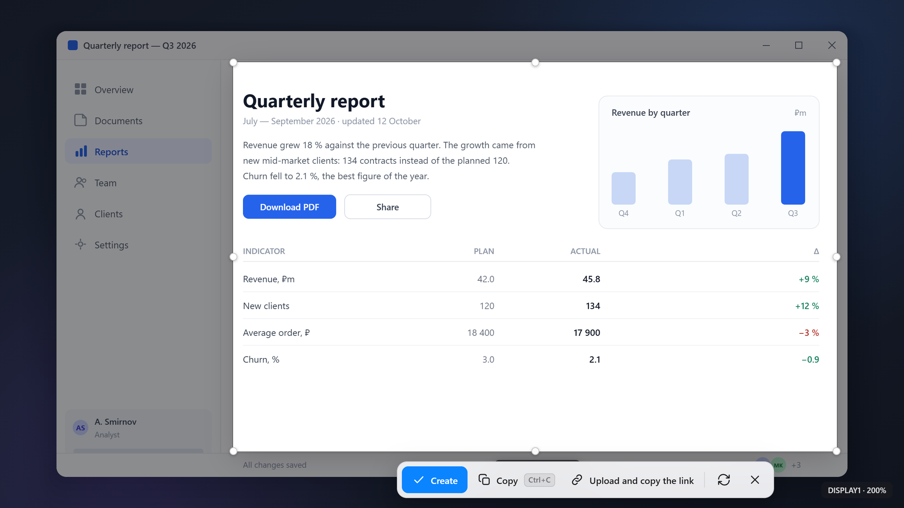
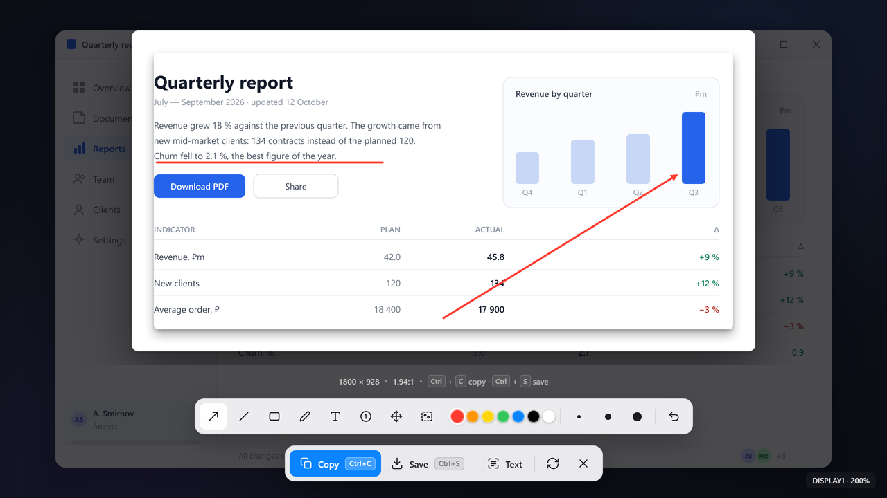
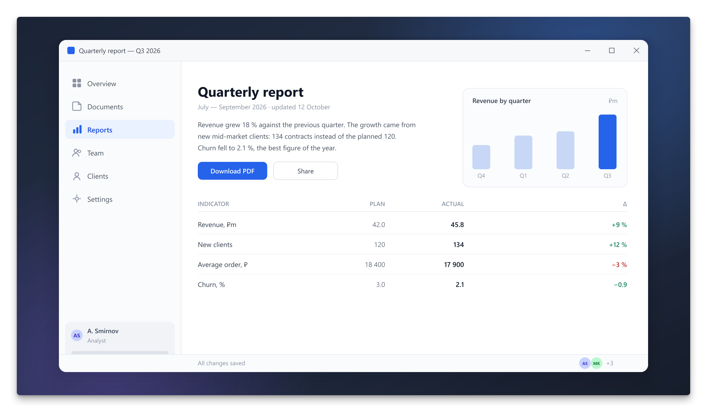
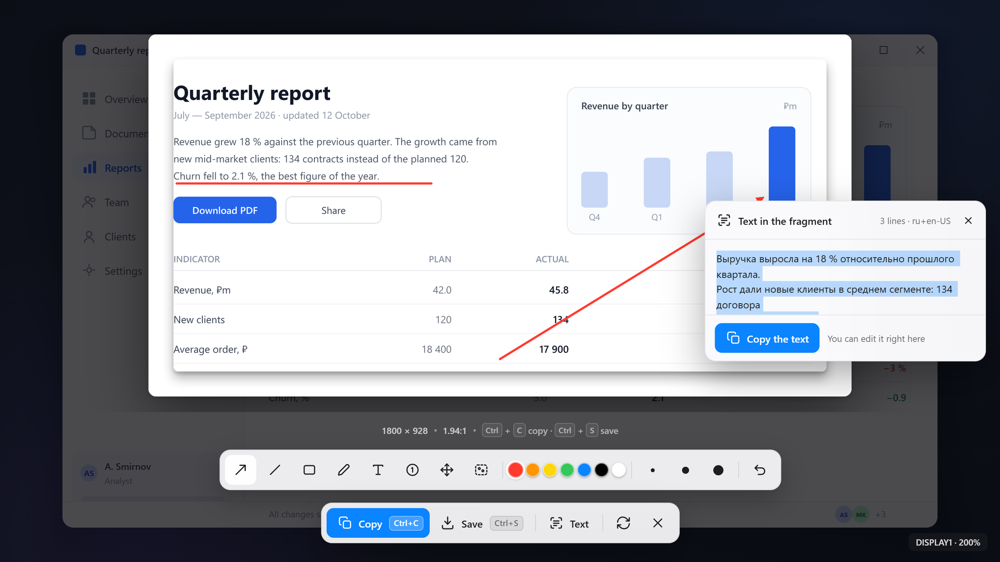
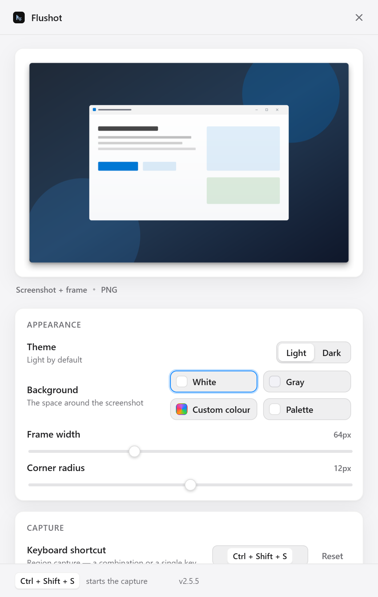
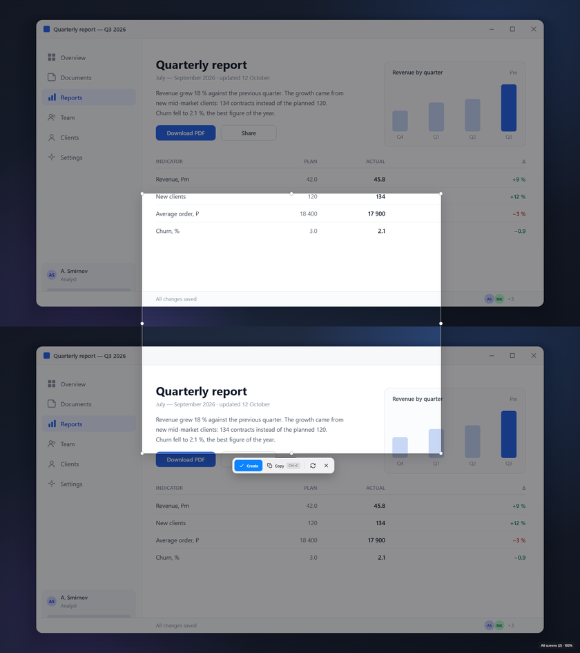

# Flushot

A screenshot tool for Windows. Select a region and the picture is already on the clipboard, ready to
paste, in a neat frame with a soft shadow and rounded corners, at full resolution. Windows 10 and 11, x64.

[](https://github.com/aeshtlv/Flushot/actions/workflows/ci.yml)
[](LICENSE)
[](CHANGELOG.md)

<p align="center">
  
</p>

| Region selection | Annotations | Result |
|---|---|---|
|  |  |  |

| Recognised text | Settings | Two monitors |
|---|---|---|
|  |  |  |

## Features

- **Select, release, paste.** Letting go of the mouse button copies the finished picture to the
  clipboard and closes the overlay, so `Ctrl+V` is the only key left to press. `Ctrl+C` is not needed.
- **Any region.** The result is your selection plus a frame, so any size works: 300×270 or 3840×2160.
  Pixels are copied one to one; nothing is stretched.
- **Framing.** Frame width 0–200 px on all four sides, colour of your choice, rounded corners, a soft
  shadow with adjustable intensity and radius — or a clean screenshot with no border.
- **Annotations.** Arrow, line, rectangle, freehand, text with word wrapping, numbered steps, blur and
  pixelate. Finished annotations can be moved. Holding `Shift` while releasing the mouse opens the
  picture for annotating instead of copying it.
- **Text recognition.** The "Text" button reads the screenshot or a selected fragment with the built-in
  Windows OCR engine: offline, nothing downloaded, the image never leaves the machine. The recognised
  text is editable in the panel.
- **Copy and save.** `Ctrl+C` to the clipboard at any moment, including mid-selection. `Ctrl+S` to a
  file. Optional auto-save — the file is still written after an automatic copy, placed after the
  clipboard and never delaying the paste. Filenames like `screenshot_2026-10-17_14-30-25.png`,
  PNG, JPEG and WebP.
- **Monitors and DPI.** The selection crosses monitor boundaries and the result is stitched at native
  resolution. Correct at Windows scaling 100, 125, 150 and 200 %.
- **Tray and hotkeys.** Separate hotkeys for a region and for the whole screen, run at login, tray icon
  that follows the taskbar theme.
- **English and Russian.** The whole interface — settings, overlay, annotation bar, tray menu, messages —
  is available in both. "Same as the system" follows the Windows language, and a language the program
  does not know falls back to English.
- **Updates.** An installed copy asks GitHub once a day whether a newer version exists, downloads it in
  the background and installs it on quit. One switch in the settings turns that off.

## Download

Prebuilt archives are attached to **[Releases](../../releases/latest)**. The program is the same in
all three; what differs is how it is installed and whether it updates itself.

| File | Description |
|---|---|
| **[Flushot-2.4.2-x64.exe](../../releases/latest/download/Flushot-2.4.2-x64.exe)** | 105 MB. Installer: Start menu shortcuts, install location, uninstaller. **Updates itself** — recommended |
| [Flushot-2.4.2-portable.zip](../../releases/latest/download/Flushot-2.4.2-portable.zip) | 94 MB. Portable single file, no installation. Updated by hand |
| [Flushot-2.4.2-win64.zip](../../releases/latest/download/Flushot-2.4.2-win64.zip) | 143 MB. Unpack anywhere and run `Flushot.exe`. Updated by hand |

Only the installer can update itself: the portable build unpacks into a temporary folder on every
launch, and the archive has no uninstaller for the updater to run. Those two are told about a new
version but have to download it from the site.

The binaries are not code-signed, so SmartScreen warns on first launch: **More info → Run anyway**.
That is standard behaviour for an unsigned executable.

<!-- downloads:begin -->
Downloaded from GitHub for **v2.4.2**: 11 — 1 portable.zip, 0 win64.zip, 10 x64.exe. 55 in total. These are downloads, not installs.
<!-- downloads:end -->

That number updates itself: once a day the `Download counter` workflow copies it from GitHub into
the README and the landing page. It counts downloads from GitHub, not installs — the program
reports nothing about itself.

Landing page: **https://flushot.ink**

## Build from source

Requires **Windows 10/11 x64** and **Node.js 20.19+ or 22.12+**.

```bash
git clone https://github.com/aeshtlv/Flushot.git
cd Flushot
npm install
npm run dev
```

```bash
npm run typecheck    # tsc for main and renderer
npm test             # 394 tests in 27 files
npm run build        # production build in out/
npm run dist         # installer and portable build in release/
npm run self-test    # end-to-end check on a live system
```

## Hotkeys

| Keys | Action |
|---|---|
| `Ctrl+Shift+S` | start selecting a region |
| `Ctrl+Shift+3` | capture the whole screen |
| release the mouse | the picture is already on the clipboard |
| `Shift` on release | open the picture for annotating instead of copying |
| `Enter` | confirm the selection and open the picture |
| `Ctrl+C` | copy to the clipboard without a preview |
| `Ctrl+S` | save the result |
| `Ctrl+Z` | undo the last annotation |
| `Esc` | reset the selection or close the overlay |
| `Shift` while drawing a line | snap to 0°, 45° or 90° |

Both capture hotkeys are configurable, including a single key without modifiers.

Copying on release can be turned off: settings → "Снимок" → "После выделения" → "Открывать".
Releasing the mouse then shows the annotation bar and `Ctrl+C` copies, as it did before.

## Updates

An installed copy asks GitHub once a day whether a newer version exists and, if one does, downloads it
in the background. It installs on quit, so nothing closes in the middle of your work. The same question
can be asked by hand: settings → "Updates" → "Check now", or the row in the tray menu.

**What goes over the network.** One request to `api.github.com` for the release list and, when an update
exists, a download from `github.com`. Nothing else is sent: no identifier, no statistics, no addresses.
GitHub sees your IP address, as it does on any request to it.

**Turning it off.** Settings → "Updates" → switch "Check for updates" off. Then there are no requests at
all and the current version stays for good; a newer one has to be downloaded from the site.

To see what a particular copy thinks, from a terminal:

```bash
"%LOCALAPPDATA%\Programs\Flushot\Flushot.exe" --update-check
```

It prints the state as JSON and exits: `ok` plus the reason in `state`. That is also how a machine that
never gets updates is diagnosed — usually a proxy, a blocked `github.com`, or a build that cannot
replace itself.

## Limitations

- Capture uses Electron, so protected content (DRM video, some exclusive-fullscreen games) may come out
  black. That is an OS restriction.
- The screenshot is taken at the moment the hotkey is pressed: the overlay shows a frozen frame.
- Only Windows is targeted; macOS and Linux builds are not configured.
- Text recognition reads only the languages installed in Windows, and it makes mistakes on small type
  and on coloured text over images. Mean character error rate on the measured set: 3.22 %.
- `Win+Shift+S` cannot be assigned while the Snipping Tool is installed: the OS keeps that combination.

## Project layout

```
src/main/        the Electron process: capture, card composition, export, recognition, settings, tray, updates
src/renderer/    the interface: selection overlay, annotation panel, settings window
src/shared/      shared types, DPI geometry, default settings, logo drawing, the string dictionary
tests/           394 unit tests
scripts/         icon and screenshot pipelines, the checks
logo/            logo.svg — the source every icon is generated from
build/           icon.png, icon.ico and the tray icons
deploy/          nginx configuration and the site deploy scripts
docs/            documentation and interface screenshots
```

No program archives live in the repository: they are attached to [Releases](../../releases).
`node_modules/`, `out/`, `release/` and `share/*.zip` are excluded through `.gitignore`.

The site is not here either: the landing page, its social images and its scripts live on the
`site` branch of the same repository. The documents under `docs/` are written in Russian;
this file and the landing page are the English versions.

## Documentation

| Document | Contents |
|---|---|
| [README.md](README.md) | full documentation in Russian: features, settings, structure |
| [docs/ARCHITECTURE.md](docs/ARCHITECTURE.md) | capture pipeline, DPI handling, image quality, OCR, performance |
| [docs/DEVELOPMENT.md](docs/DEVELOPMENT.md) | commands, self-test, packaging, screenshot checks |
| [docs/GITHUB.md](docs/GITHUB.md) | publishing releases and the site |
| [docs/HOSTING.md](docs/HOSTING.md) | server, domain, HTTPS, deploying the site |
| [CHANGELOG.md](CHANGELOG.md) | version history |
| [docs/ROADMAP.md](docs/ROADMAP.md) | planned directions |
| [CONTRIBUTING.md](CONTRIBUTING.md) | how to build and what to check before a pull request |

## License

[MIT](LICENSE).
