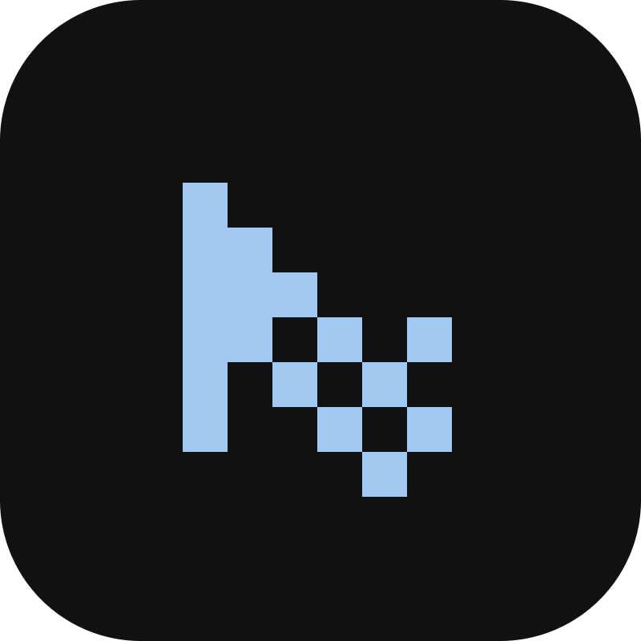
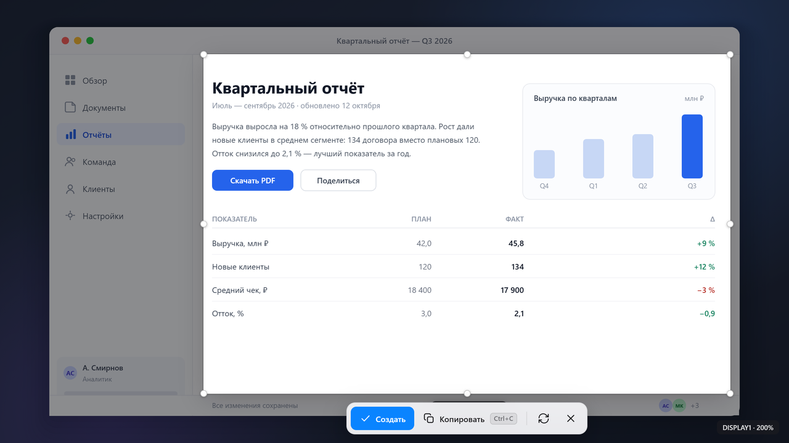
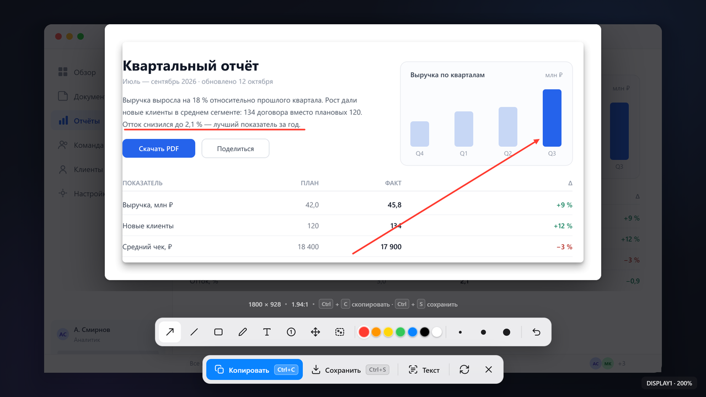
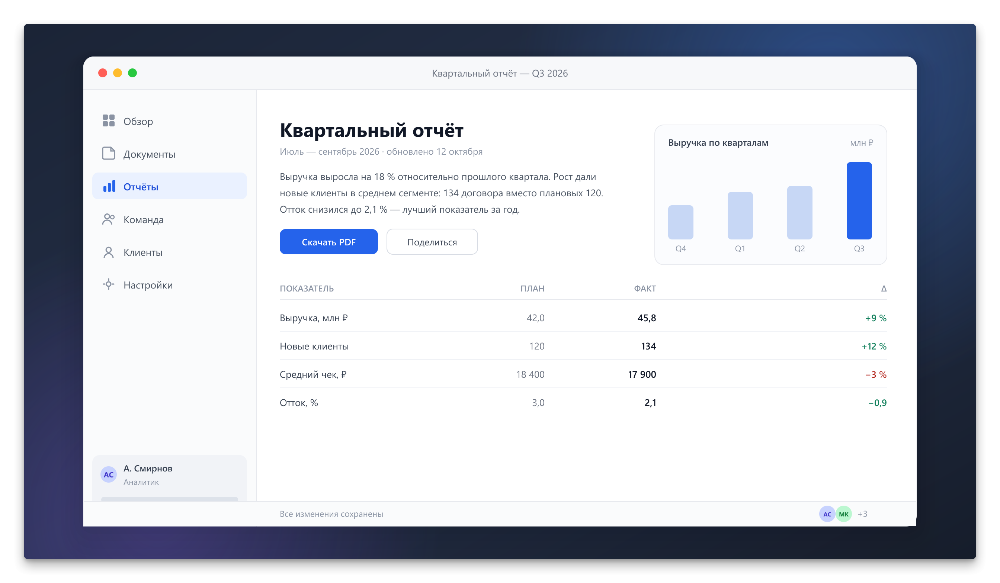
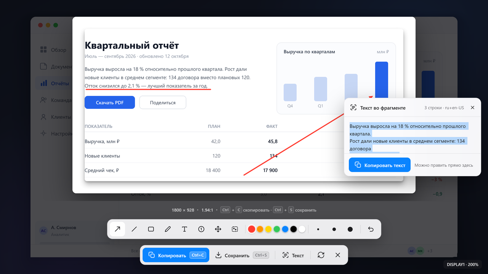
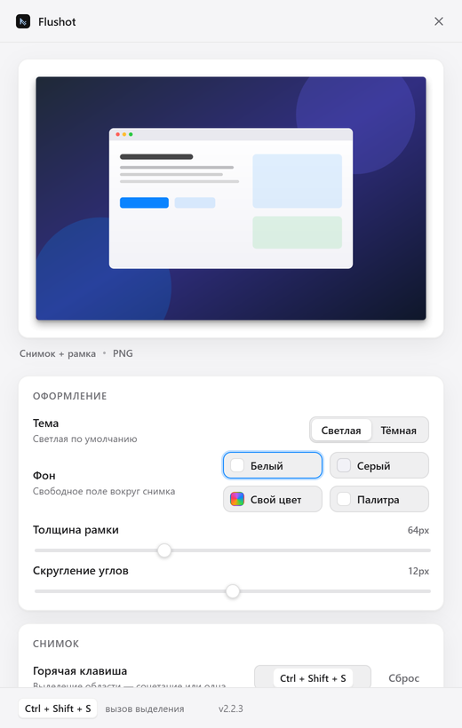
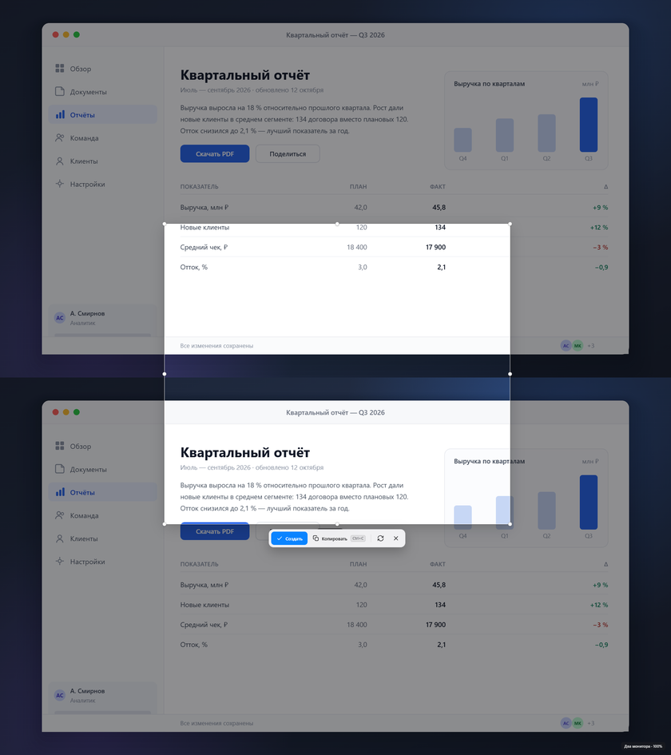

# Flushot

**Снимок экрана в стиле Lightshot, оформленный как в macOS.** Выделяете область — Flushot отдаёт её
в аккуратной рамке с мягкой тенью и скруглёнными углами, без потери качества. Windows 10 и 11.

<p align="center">
  
</p>

| Выделение области | Пометки на снимке | Готовая карточка |
|---|---|---|
|  |  |  |

| Распознанный текст | Настройки | Снимок через два монитора |
|---|---|---|
|  |  |  |

<sub>Кадры сняты скриптом `scripts/make-ui-shots.cjs` в настоящей сборке интерфейса в браузере — не с вашего
рабочего стола. Подробнее в [docs/DEVELOPMENT.md](docs/DEVELOPMENT.md#сайт-кадры-и-проверки).</sub>

---

## Что умеет

| | |
|---|---|
| **Снимок любой области** | результат — ровно ваше выделение плюс рамка, поэтому размер может быть любым: 300×270 или 3840×2160. Пропорции не меняются, пиксели идут один-к-одному |
| **Оформление карточки** | рамка с четырёх сторон (0–200 px), цвет на выбор, скругление углов, тень как в macOS Quick Look — или чистый снимок без полей |
| **Пометки** | стрелка, линия, рамка, карандаш, текст с переносом по словам, нумерованные шаги, перемещение готовых пометок, размытие и пикселизация приватных мест |
| **Распознавание текста** | кнопка «Текст» читает снимок или обведённый фрагмент встроенным движком Windows: офлайн, без загрузок, снимок не покидает компьютер. Текст можно править прямо в панели |
| **Копирование и сохранение** | `Ctrl+C` сразу в буфер (в том числе во время выделения), `Ctrl+S` в файл, автосохранение в папку, имена вида `screenshot_2026-10-17_14-30-25.png`, форматы PNG, JPEG, WebP |
| **Несколько мониторов и DPI** | выделение тянется через границу экранов, результат собирается в исходном разрешении; корректно при масштабе Windows 100, 125, 150 и 200 % |
| **Трей и горячие клавиши** | своя клавиша для области и отдельная для всего экрана, автозапуск с Windows, значок в трее подстраивается под тему панели задач |

## Скачать

Готовые сборки лежат в **[Releases](../../releases/latest)** — устанавливать ничего не нужно:

| Файл | Что это |
|---|---|
| **[Flushot-2.2.8-win64.zip](../../releases/latest/download/Flushot-2.2.8-win64.zip)** | **самый надёжный вариант** (161 МБ): распаковать и запустить `Flushot.exe` |
| [Flushot-2.2.8-portable.zip](../../releases/latest/download/Flushot-2.2.8-portable.zip) | portable-версия (113 МБ), один файл без установки |
| [Flushot-2.2.8-installer.zip](../../releases/latest/download/Flushot-2.2.8-installer.zip) | установщик NSIS (113 МБ): ярлыки, выбор папки, деинсталлятор |

Сборки не подписаны сертификатом разработчика, поэтому SmartScreen может показать «Windows защитила ваш
компьютер» — **«Подробнее» → «Выполнить всё равно»**. Это обычное поведение для локально собранного exe.

> **«Error writing temporary file. Make sure your temp folder is valid»** — так сообщает упаковщик NSIS,
> когда папка `%TEMP%` недоступна для записи. Проще всего взять `win64.zip`: ZIP-сборке временная папка
> не нужна. Само приложение тоже устойчиво к этому — если `%TEMP%` недоступен, оно переключается на
> `%APPDATA%\Flushot\temp`.

Подробная инструкция для получателя — в [share/ПРОЧТИ МЕНЯ.txt](share/ПРОЧТИ%20МЕНЯ.txt).

## Запуск из исходников

Нужны **Windows 10/11 x64** и **Node.js 20.19+ или 22.12+**.

```bash
git clone <адрес этого репозитория> && cd Flushot
npm install
npm run dev
```

При первом запуске открывается окно настроек, приложение остаётся в трее. Горячие клавиши по умолчанию —
`Ctrl+Shift+S` (выделить область) и `Ctrl+Shift+3` (сразу весь экран); обе меняются в настройках.

```bash
npm run typecheck    # tsc для main и renderer
npm test             # Vitest: 351 тест в 23 файлах
npm run build        # production-сборка в out/
npm run dist         # установщик и portable в release/
npm run self-test    # сквозная проверка на живой системе
```

## Клавиши

| Клавиши | Действие |
|---|---|
| `Ctrl+Shift+S` | начать выделение (настраивается, работает в фоне) |
| `Ctrl+Shift+3` | снимок всего экрана сразу (настраивается отдельно) |
| `Enter` | подтвердить выделение |
| `Ctrl+C` | скопировать сразу в буфер, без предпросмотра |
| `Ctrl+S` | сохранить результат |
| `Ctrl+Z` | отменить последнюю пометку |
| `Esc` | сбросить выделение / закрыть оверлей |
| `Shift` при рисовании линии | прилипание к 0°, 45° или 90° |

В поле распознанного текста клавиши ведут себя как в обычном текстовом поле: `Ctrl+C` копирует слова,
`Ctrl+Z` отменяет правку, `Esc` снимает фокус. `Ctrl+S` по-прежнему сохраняет снимок.

## Настройки

Хранятся в `%APPDATA%\Flushot\settings.json`, пишутся атомарно; повреждённый файл переименовывается в
`.corrupt-*`, и приложение стартует со значениями по умолчанию.

| Раздел | Параметры |
|---|---|
| Снимок | горячая клавиша области, отдельная клавиша «весь экран», автозапуск с Windows |
| Оформление | тема, фон (белый, светло-серый, свой), своя палитра до 6 цветов, толщина рамки 0–200 px, скругление 0–24 px |
| Тень | вкл/выкл, интенсивность 0–60 %, радиус 0–48 px |
| Сохранение | папка (по умолчанию `Изображения\Flushot`), режим «в папку» или «спрашивать», формат PNG/JPEG/WebP, качество 60–100 |

## Ограничения

Честный список, а не мелкий шрифт:

- Захват идёт средствами Electron; защищённый контент (DRM, часть игр в exclusive fullscreen) может выйти
  чёрным — это ограничение ОС, а не приложения.
- Снимок делается в момент нажатия клавиши: оверлей показывает замороженный кадр, движущийся контент
  не «убегает» во время выделения.
- Сборка под macOS и Linux не настроена: приложение ориентировано на Windows 10/11.
- Распознавание читает только те языки, что установлены в Windows, и ошибается на мелком шрифте и цветном
  тексте поверх картинки. Это не OCR для сканов: средняя ошибка на замеренном наборе — 3,22 %, и там, где
  все чтения сходятся на неверном, панель правится руками.
- `Win+Shift+S` занять нельзя, пока установлены «Ножницы»: сочетание принадлежит им на уровне системы.

## Устройство проекта

```
src/main/        процесс Electron: захват, сборка карточки, экспорт, OCR, настройки, трей
src/renderer/    интерфейс: оверлей выделения, панель пометок, окно настроек
src/shared/      общие типы, геометрия DPI, настройки по умолчанию, единственный рисунок логотипа
tests/           351 модульный тест: геометрия, пиксели карточки, экспорт, OCR, логотип
scripts/         сборка значков, сайта, кадров и проверки без браузера
logo/            logo.svg — исходник, из которого собираются все значки
site/            статический лендинг
docs/            документация и кадры интерфейса
```

## Документация

| Документ | О чём |
|---|---|
| [docs/ARCHITECTURE.md](docs/ARCHITECTURE.md) | как устроено внутри: захват, DPI, склейка мониторов, качество, OCR, скорость, логотип |
| [docs/DEVELOPMENT.md](docs/DEVELOPMENT.md) | требования, команды, самопроверка, упаковка, проверки сайта и кадров, описание тестов |
| [docs/GITHUB.md](docs/GITHUB.md) | как выложить проект на GitHub: репозиторий, релиз с архивами, GitHub Pages |
| [CHANGELOG.md](CHANGELOG.md) | что менялось от версии к версии и почему |
| [docs/ROADMAP.md](docs/ROADMAP.md) | что можно добавить дальше |
| [CONTRIBUTING.md](CONTRIBUTING.md) | как собрать, что проверить перед pull request |

Есть английская версия: [README.en.md](README.en.md).

## Лицензия

[MIT](LICENSE). Логотип и иконки — часть проекта.
