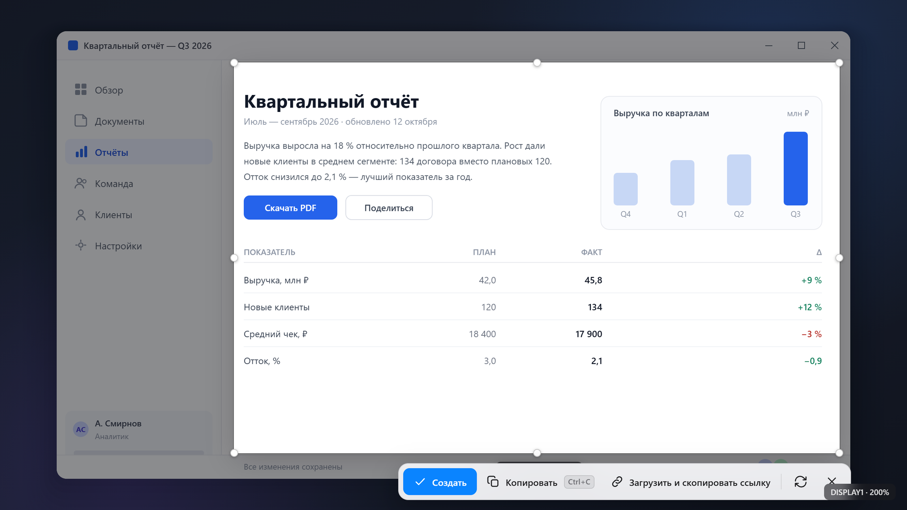
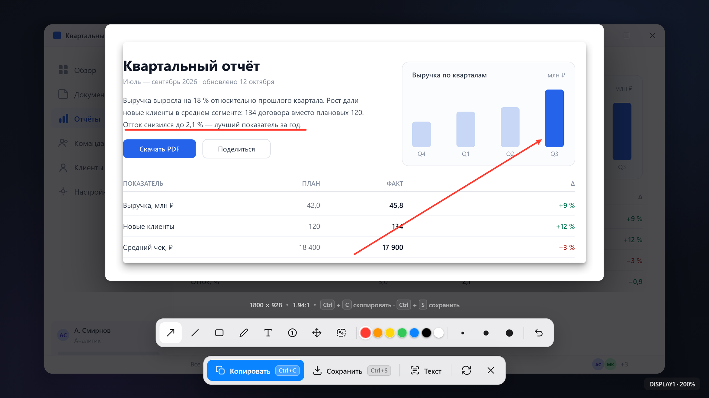
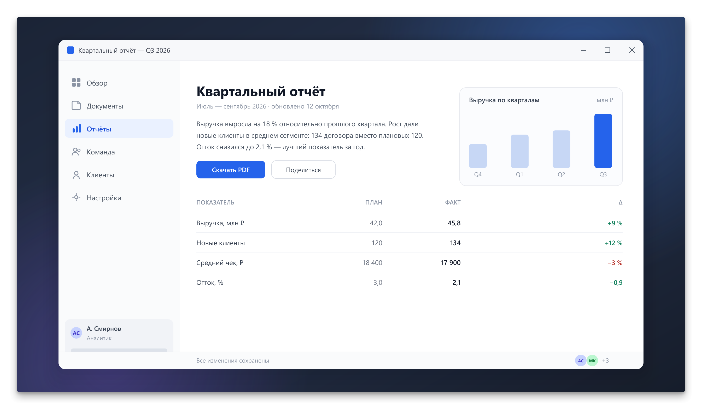
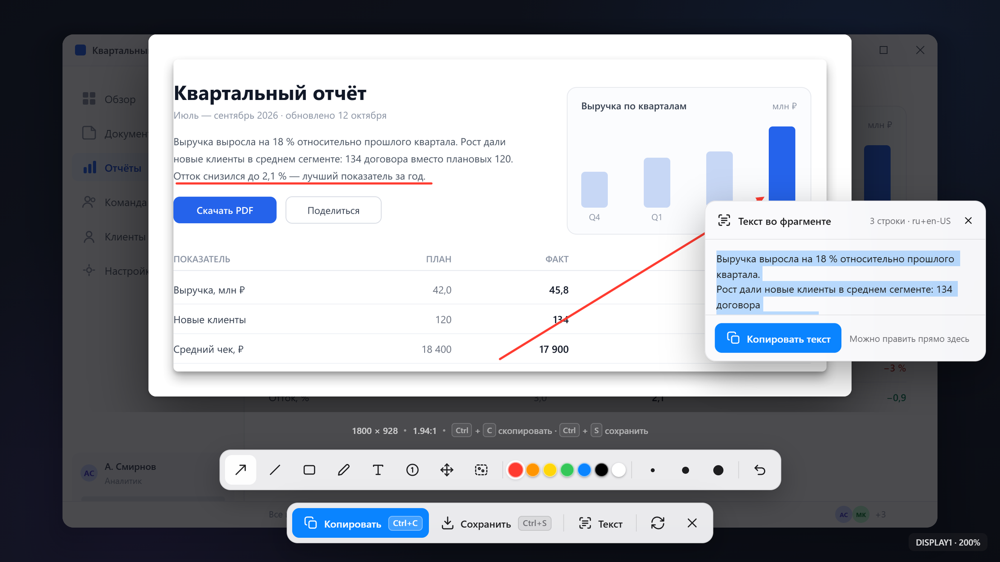
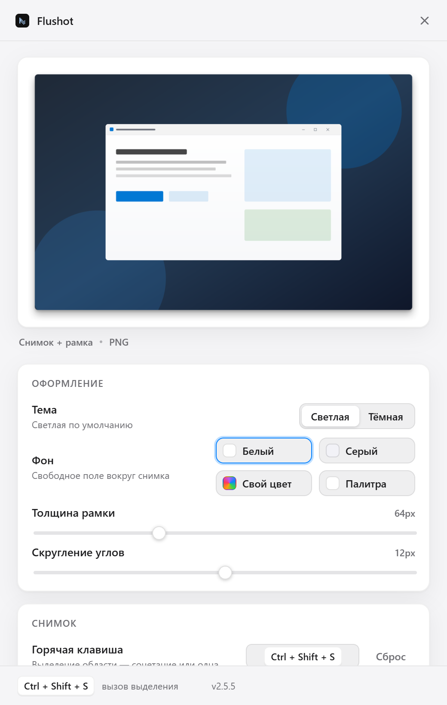
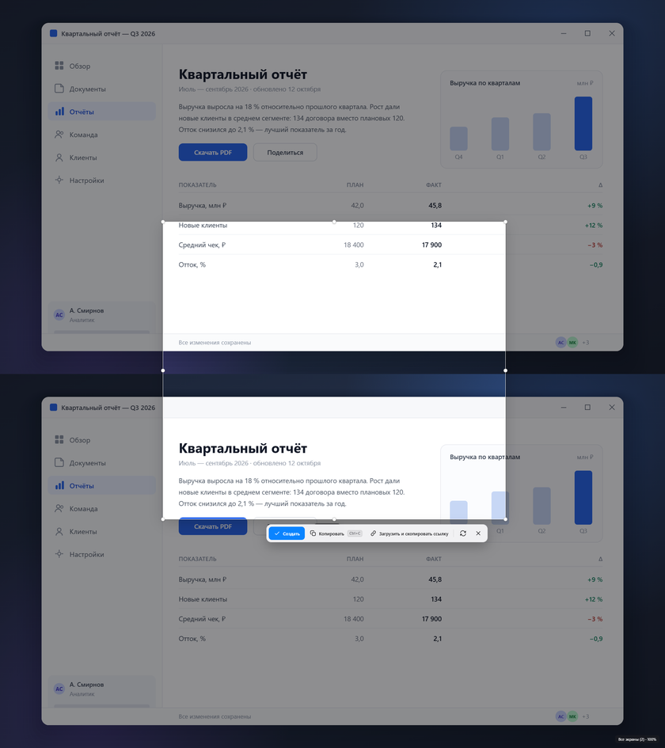

# Flushot

Программа для скриншотов на Windows. Выделяете область — снимок сразу оказывается в буфере обмена,
готовый к вставке, в аккуратной рамке с мягкой тенью и скруглёнными углами, без потери качества.
Windows 10 и 11, x64.

[](https://github.com/aeshtlv/Flushot/actions/workflows/ci.yml)
[](LICENSE)
[](CHANGELOG.md)

<p align="center">
  
</p>

| Выделение области | Пометки | Результат |
|---|---|---|
|  |  |  |

| Распознанный текст | Настройки | Два монитора |
|---|---|---|
|  |  |  |

## Возможности

- **Выделил — и вставляй.** Отпускание кнопки мыши копирует готовый снимок в буфер обмена
  и закрывает оверлей, поэтому следующим движением остаётся `Ctrl+V` в чате, письме или документе.
  Нажатия `Ctrl+C` этот путь не требует.
- **Снимок любой области.** Результат — выделение плюс рамка, поэтому размер произвольный:
  от 300×270 до 3840×2160. Изображение не масштабируется, пиксели копируются один к одному.
- **Оформление.** Рамка 0–200 px с четырёх сторон, цвет на выбор, скругление углов, мягкая тень
  с настройкой интенсивности и радиуса — или чистый снимок без полей.
- **Пометки.** Стрелка, линия, прямоугольник, карандаш, текст с переносом по словам, нумерованные
  шаги, размытие и пикселизация приватных участков. Готовые пометки можно перемещать. `Shift`,
  удерживаемый при отпускании мыши, открывает снимок для пометок вместо копирования.
- **Распознавание текста.** Кнопка «Текст» читает снимок или обведённый фрагмент встроенным движком
  Windows: офлайн, без загрузок, изображение не покидает компьютер. Текст правится в панели.
- **Копирование и сохранение.** `Ctrl+C` — в буфер в любой момент, в том числе во время выделения.
  `Ctrl+S` — в файл. Автосохранение в папку (снимок пишется и после автоматического копирования,
  запись идёт уже после буфера и не задерживает вставку), имена вида
  `screenshot_2026-10-17_14-30-25.png`, форматы PNG, JPEG и WebP.
- **Мониторы и DPI.** Выделение тянется через границу экранов, результат собирается в исходном
  разрешении. Корректно при масштабе Windows 100, 125, 150 и 200 %.
- **Трей и горячие клавиши.** Отдельные клавиши для области и для всего экрана, автозапуск с Windows,
  значок в трее следует теме панели задач.
- **Обновления.** Установленная версия раз в сутки спрашивает у GitHub, не вышла ли новая, скачивает её
  в фоне и ставит при выходе. Выключается одним переключателем в настройках.

## Установка

Готовые сборки — в [Releases](../../releases/latest). Программа внутри одинаковая, отличается способ
установки и то, обновляется ли она сама.

| Файл | Описание |
|---|---|
| **[Flushot-2.5.2-x64.exe](../../releases/latest/download/Flushot-2.5.2-x64.exe)** | 105 МБ. Установщик: ярлыки в меню «Пуск», выбор папки, деинсталлятор. **Обновляется сам** — рекомендуемый вариант |
| [Flushot-2.5.2-portable.zip](../../releases/latest/download/Flushot-2.5.2-portable.zip) | 94 МБ. Portable-версия одним файлом, без установки. Обновлять вручную |
| [Flushot-2.5.2-win64.zip](../../releases/latest/download/Flushot-2.5.2-win64.zip) | 148 МБ. Распаковать в любую папку и запустить `Flushot.exe`. Обновлять вручную |

Автообновление работает только у установщика: portable-версия при каждом запуске распаковывается во
временную папку, а версия из архива ставится без деинсталлятора — replace-механизм не может их
заменить. Остальные две спрашивают о новой версии, но предлагают скачать её вручную.

Сборки не подписаны сертификатом разработчика, поэтому при первом запуске SmartScreen показывает
предупреждение: **«Подробнее» → «Выполнить всё равно»**. Это стандартное поведение для неподписанного
исполняемого файла.

<!-- downloads:begin -->
**v2.5.2** выпущена только что, скачиваний пока нет — за всё время 82. Считаются скачивания, не установки.
<!-- downloads:end -->

Число выше обновляется само: раз в сутки workflow `Download counter` переписывает его из
GitHub в README и на страницу. Это счётчик скачиваний с GitHub, а не установок — программа про
себя ничего не сообщает.

Страница программы с описанием и кнопками скачивания: **https://flushot.ink**

## Сборка из исходников

Требования: **Windows 10/11 x64**, **Node.js 20.19+ или 22.12+**, npm.

```bash
git clone https://github.com/aeshtlv/Flushot.git
cd Flushot
npm install
npm run dev
```

При первом запуске открывается окно настроек, приложение остаётся в трее.

```bash
npm run typecheck    # tsc для main и renderer
npm test             # 394 теста в 27 файлах
npm run build        # production-сборка в out/
npm run dist         # установщик и portable в release/
npm run self-test    # сквозная проверка на живой системе
```

## Горячие клавиши

| Клавиши | Действие |
|---|---|
| `Ctrl+Shift+S` | начать выделение области |
| `Ctrl+Shift+3` | снимок всего экрана |
| `Ctrl+Shift+U` | снимок уходит на сервер, в буфер попадает ссылка на него |
| отпустить мышь | снимок уже в буфере обмена |
| `Shift` при отпускании мыши | открыть снимок для пометок вместо копирования |
| `Enter` | подтвердить выделение и открыть снимок |
| `Ctrl+C` | скопировать в буфер без предпросмотра |
| `Ctrl+S` | сохранить результат |
| `Ctrl+Z` | отменить последнюю пометку |
| `Esc` | сбросить выделение или закрыть оверлей |
| `Shift` при рисовании линии | прилипание к 0°, 45° или 90° |

Все три клавиши запуска переназначаются в настройках, в том числе на одну клавишу без
модификаторов. Ни одна из них не срабатывает дважды: сочетание, занятое одним действием, второе
не получит — настройки скажут, какое именно действие его держит.
В поле распознанного текста клавиши работают как в обычном текстовом поле; `Ctrl+S` при этом
по-прежнему сохраняет снимок.

Копирование при отпускании мыши можно выключить: настройки → «Снимок» → «После выделения» →
«Открывать». Тогда отпускание показывает панель пометок, а копирует `Ctrl+C` — как было раньше.

### Снимок со ссылкой

Третья клавиша, `Ctrl+Shift+U`, снимает область и отправляет готовый снимок на сервер, а в буфер
кладёт ссылку вида `https://flushot.ink/s/xxxxxxxxxxxxxxxx.png`. Расширение — `.png` или `.webp` в
зависимости от формата в настройках; сервер проверяет содержимое по первым байтам файла, а не
верит расширению.

Ссылка живёт час. Затем файл удаляется, и по ссылке открывается страница «Ссылка истекла».

Это единственная функция, которая отправляет снимок в сеть. Две другие клавиши работают только на
вашем компьютере, и нажимать эту никто не обязан. Что именно хранится и как погасить ссылку раньше
срока — на странице [о приватности](https://flushot.ink/privacy.html).

Серверная часть живёт в `deploy/shots/`: эндпоинт на Python (стандартная библиотека, 3.6),
nginx-конфигурация, юниты systemd и установщик. Квота — 2 ГБ, при заполнении удаляется самое старое;
загрузка отказывает, если на диске осталось меньше 1,5 ГБ, чтобы не забить систему.

Интерфейс говорит на русском и английском: настройки → «Язык». Значение «Как в системе» берёт язык
Windows — русская система показывает русский, любая другая английский.

## Обновления

Установленная версия раз в сутки спрашивает у GitHub, не вышла ли новая, и если вышла — скачивает её
в фоне. Установка происходит при выходе, поэтому ничего не закрывается посреди работы. Тот же вопрос
можно задать руками: настройки → «Обновления» → «Проверить сейчас», или строка в меню трея.

**Что уходит в сеть.** Один запрос к `api.github.com` за списком релизов и, когда обновление найдено,
скачивание файла с `github.com`. Ничего другого программа не отправляет: ни идентификатора, ни
статистики, ни адресов. GitHub при этом видит IP-адрес — как и при любом другом обращении к нему.

**Как выключить.** Настройки → «Обновления» → выключить «Проверять обновления». Тогда запросов нет
совсем, и текущая версия остаётся навсегда; скачать новую можно с сайта.

Проверить, что думает об обновлении конкретная копия, можно из командной строки:

```bash
"C:\Users\<имя>\AppData\Local\Programs\Flushot\Flushot.exe" --update-check
```

Команда печатает состояние в JSON и выходит: поле `ok` и причина в `state`. Это же показывает,
почему обновление не приходит — обычно это прокси, закрытый `github.com` или сборка, которая не
может заменять себя.

Загрузка проверяется так же:

```bash
"C:\Users\<имя>\AppData\Local\Programs\Flushot\Flushot.exe" --upload-check
"…\Flushot.exe" --upload-check --format=webp
```

Команда собирает карточку из синтетической картинки, кодирует её в выбранном формате, отправляет,
скачивает обратно и сверяет байты, а затем удаляет ссылку, чтобы ничего не оставлять на сервере.
В ответе — `ok`, `url`, `ttl`, `roundTrip` и, если что-то не так, `error` с первопричиной в
`detail`. Экран для этого не нужен.

## Ограничения

- Захват выполняется средствами Electron, поэтому защищённый контент (DRM, часть игр в exclusive
  fullscreen) может выйти чёрным. Это ограничение операционной системы.
- Снимок делается в момент нажатия клавиши: оверлей показывает замороженный кадр.
- Сборка под macOS и Linux не настроена.
- Распознавание читает только языки, установленные в Windows, и ошибается на мелком шрифте и цветном
  тексте поверх изображения. Средняя ошибка на тестовом наборе — 3,22 %.
- `Win+Shift+S` нельзя назначить, пока установлены «Ножницы»: сочетание закреплено за ними
  на уровне системы.

## Структура проекта

```
src/main/        процесс Electron: захват, сборка карточки, экспорт, распознавание, настройки, трей, обновления
src/renderer/    интерфейс: оверлей выделения, панель пометок, окно настроек
src/shared/      общие типы, геометрия DPI, настройки по умолчанию, рисунок логотипа, словарь строк
tests/           394 модульных теста
scripts/         сборка значков и кадров, проверки
logo/            logo.svg — исходник, из которого собираются все значки
build/           icon.png, icon.ico и значки трея
deploy/          конфигурация nginx и скрипты выкладки сайта
docs/            документация и кадры интерфейса
```

Архивов с программой в репозитории нет: они лежат в [Releases](../../releases). `node_modules/`,
`out/`, `release/` и `share/*.zip` исключены через `.gitignore`.

Страницы программы здесь тоже нет: лендинг, картинки для соцсетей и его скрипты живут в ветке
`site` того же репозитория.

## Документация

| Документ | Содержание |
|---|---|
| [docs/ARCHITECTURE.md](docs/ARCHITECTURE.md) | внутреннее устройство: захват, DPI, склейка мониторов, качество, распознавание, скорость, обновления |
| [docs/DEVELOPMENT.md](docs/DEVELOPMENT.md) | команды, самопроверка, упаковка, проверки, описание тестов |
| [docs/GITHUB.md](docs/GITHUB.md) | публикация релизов и сайта |
| [docs/HOSTING.md](docs/HOSTING.md) | сервер, домен, HTTPS, выкладка сайта |
| [CHANGELOG.md](CHANGELOG.md) | история версий |
| [docs/ROADMAP.md](docs/ROADMAP.md) | направления развития |
| [CONTRIBUTING.md](CONTRIBUTING.md) | как собрать проект и что проверить перед pull request |

Английская версия: [README.en.md](README.en.md).

## Лицензия

[MIT](LICENSE).
