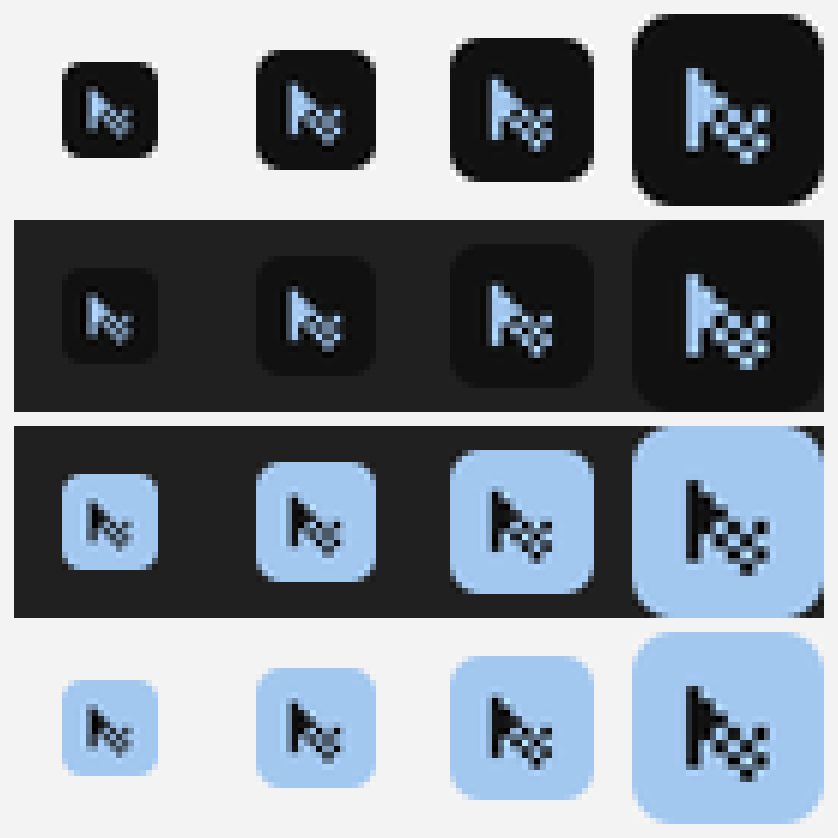

# Как устроен Flushot

Внутренности: захват экрана, сборка карточки, качество, распознавание текста, скорость и логотип.
Пользовательские возможности описаны в [README](../README.md), сборка и тесты — в [DEVELOPMENT.md](DEVELOPMENT.md).

---

## Путь одного снимка

1. Своя клавиша (по умолчанию `Ctrl+Shift+S`) — экран замораживается и затемняется, поверх **всех** мониторов появляется один слой выделения, поэтому прямоугольник можно растянуть через границу экранов.
2. Выделите область мышью (или сразу нажмите `Enter`). Размер выделения показывается в пикселях физического экрана.
3. Нажмите «Создать» — Flushot вырезает область в исходном разрешении и добавляет вокруг неё рамку выбранного цвета. Размер результата — ровно ваше выделение плюс рамка, поэтому он может быть любым. Готовый снимок можно сразу скопировать через `Ctrl+C` прямо на этапе выделения.
4. Рядом с результатом — панель пометок: **стрелка**, **рамка**, **карандаш**, **текст**, **шаги**, **перемещение**, **скрыть область**, палитра, толщина линии и отмена. Рисуйте прямо на снимке, затем копируйте или сохраняйте.
5. Панель действий: **Копировать** (`Ctrl+C`), **Сохранить** (`Ctrl+S`), **Текст** (распознавание), **Выделить заново**, **Отменить**. Под карточкой та же мысль словами: «`Ctrl+C` скопировать · `Ctrl+S` сохранить» — чтобы не приходилось догадываться, что снимок уже готов.

### Пометки на снимке

Панель пометок появляется вместе с результатом, поэтому аннотировать можно без отдельного редактора:

| Инструмент | Что делает | Подсказка |
|---|---|---|
| Стрелка | указать на элемент | тянется от начала к концу, наконечник масштабируется вместе с линией |
| Линия | подчеркнуть строку | ровный отрезок без наконечника; `Shift` прилипает к 0°, 45° или 90° |
| Рамка | обвести область | скругление пропорционально толщине линии |
| Карандаш | свободная линия | одиночный клик оставляет точку |
| Текст | подпись | переносится по словам, четыре размера, `Shift+Enter` — жёсткий перенос, `Enter` подтверждает, `Esc` отменяет; обводка держит читаемость на любом фоне |
| Шаги | метки 1, 2, 3… | один клик ставит метку; номер = максимальный + 1, цифры контрастные |
| Перемещение | подвинуть готовую пометку | тянете форму в другое место; у стрелки и рамки двигаются оба конца, размер и цвет сохраняются |
| Скрыть область | размытие или пикселизация | берёт пиксели из настоящего снимка, а не из превью |

- **Цвета:** семь готовых плюс ваши сохранённые из настроек.
- **Толщина:** три варианта, задаются в долях от меньшей стороны снимка — линия выглядит одинаково и на снимке 400 px, и на 4K.
- **Размер текста и меток:** четыре варианта, тоже в долях от меньшей стороны, поэтому подпись не «тонет» на большом снимке и не выглядит огромной на маленьком.
- **Правка подписи:** клик по готовому тексту инструментом «Текст» открывает его заново с тем же содержимым; `Esc` возвращает исходное.
- **Перемещение:** форма ловится за контур, а не за всю площадь — иначе большая рамка перехватывала бы клики внутри себя и до пометок под ней было не добраться. Подпись и метка шага ловятся целиком.
- **Отмена:** `Ctrl+Z` убирает последнюю пометку, кнопка со стрелкой делает то же.
- **Масштаб:** если снимок больше экрана (например, через два монитора), под панелью есть ползунок от «вписано» до 100 %, кнопки `−`/`+`, кнопка «вписать» и процент. На 100 % картинку можно тащить мышью за фон, чтобы добраться до любого края; `+`, `−` и `0` работают с клавиатуры.
- **Где живут пометки:** только в текущем сеансе. Они наносятся на изображение в момент копирования или сохранения, исходный снимок не меняется.

Почему пометки не портят качество:

- Канва рисования имеет **ровно тот же размер в пикселях, что и снимок**. То, что видно в карточке, — уменьшенная копия готового растра, а не отдельная отрисовка.
- Координаты хранятся **нормализованными (0–1)**, поэтому пометки остаются на месте при любой толщине рамки.
- Перед отправкой слой накладывается на картинку в полном разрешении и маскируется по скруглённым углам — краска не затекает в прозрачные углы.
- Слои накладываются **одним проходом**: два последовательных `.composite()` в sharp не накапливаются, и маска стирала бы нарисованное. Это проверяется тестом.

`Ctrl+C` работает уже **во время выделения**: выделили область → `Ctrl+C` → оверлей закрылся, готовый снимок в буфере обмена (файл при этом не создаётся). Это самый быстрый путь, когда снимок нужен сразу в чат или документ.

Клавиша срабатывает в двух независимых режимах: обработчик в самом окне выделения (по физическому коду клавиши, поэтому работает и при русской раскладке) и глобальная регистрация `Ctrl+C` на время выделения — она нужна, потому что Windows не всегда отдаёт фокус окну, созданному из фонового приложения. Пока оверлей открыт, `Ctrl+C` принадлежит Flushot.

Если в настройках выбран режим «Сохранять в папку», файл создаётся автоматически при подтверждении выделения — панель нужна только для копирования или повторного сохранения.

`Ctrl+C` нажимается после того, как вы отпустили кнопку мыши: выделение уже зафиксировано, и снимок уходит в буфер. Если область меньше 8×8 px, Flushot подскажет, что нужно выделить больше.

### Распознавание текста: почему движок Windows, а не Tesseract

Кнопка «Текст» на панели действий достаёт надписи с картинки — либо со всего снимка, либо из обведённого фрагмента. Вопрос был не «как», а «чем», и вариантов три:

| Вариант | Что требует | Почему нет |
|---|---|---|
| Облако (Google Vision, Azure) | аккаунт, ключ, интернет; снимок уходит на чужой сервер | скриншот — это часто чужой чат, почта или документ. Отправлять его наружу нельзя, да и «работает офлайн» перестало бы быть правдой |
| Tesseract | нативный модуль + 10–30 МБ на каждый язык | +20–60 МБ к дистрибутиву, сборка под Windows через node-gyp, и всё это ради качества, которое на скриншотах интерфейса не лучше |
| **`Windows.Media.Ocr`** | ничего: движок уже в Windows | **выбрано** |

Встроенный движок — тот же, что у «Ножниц» и «Быстрых действий». Ноль байт в дистрибутиве, ноль загрузок, ноль сетевых запросов, снимок не покидает машину. Языки — те, что установлены в Windows (на этой машине `ru` и `en-US`); `MaxImageDimension` = 10 000 px.

**Но одного движка мало.** Движок Windows одноязычный: он знает только буквы своего языка. На этой машине профильный язык — `ru`, и английскую строку он читал как «KBaPTanbHbli OT"äT» — 83,7 % символов неверно. Английский движок на русском ошибался ровно так же часто в другую сторону: «HaapoVIKM npmnoxeHv•1R». Смешанный снимок, каких большинство (интерфейс по-русски, команды и пути по-английски), не может прочитать ни один из них по отдельности. Поэтому читают все установленные движки, а `src/main/ocr/merge.ts` сводит их ответы:

| Что делает | Как | Почему так |
|---|---|---|
| Собирает строки картинки | рамки строк всех движков группируются по перекрытию, а не по схожести текста | текст как раз и расходится — ради этого всё и делается; пиксели же одни и те же |
| Выбирает лучшее чтение строки | балл = правдоподобность по заглавным буквам минус «протекание» чужого алфавита минус доля слов с цифрой внутри | заглавные ловят подделку `Bblpyvxa`, но пропускают `Haapov7Kb4`; вклеенная внутрь слова цифра не пропускает |
| Дописывает хвост | если другое чтение продолжается правее, его слова добавляются в конец | русский движок обрывал строку на `Папка по умолчанию:` — латинский хвост просто исчезал |
| Отдаёт чужие слова | слово заменяется, если оно написано не в алфавите движка, либо выбивается из строки, где 85 % одного алфавита | `portabIe` → `portable`, `прт` → `npm`: каждый движок спрашивается про то, на чём обучен |
| Не трогает смешанные строки | замена только там, где строка почти целиком одного алфавита | `Папка по умолчанию: app.getPath(...)` — 53 % латиницы, законную не отличить от подделки |
| При равном счёте берёт заметно длинное | «на 60 % длиннее или на 4 буквы», порог подобран замером | движки чаще теряют кусок строки, чем путают букву |

Замерено на известном тексте: смешанный снимок давал 17,1 % неверных символов одним движком и **2,3 %** после склейки. На 14 сочетаниях шрифта и размера (страница настоящего интерфейсного текста 11–20 px, четыре гарнитуры) свод по строкам даёт **5,74 %** против **11,80 %** у прежнего выбора по всему снимку. Чисто английский: `ru` — 0,86 балла, `en-US` — 1,00. Чисто русский: `ru` — 1,00, `en-US` — 0,54. Движков запускается не больше трёх, иначе пять языковых пакетов растянули бы нажатие до четырёх секунд.

Из Node WinRT напрямую недоступен, поэтому:

- **Постоянный рабочий процесс.** `src/main/ocr/worker.ts` запускает PowerShell один раз (`-EncodedCommand`, base64 UTF-16LE — иначе кавычки и не-ASCII ломают разбор) и общается с ним строками JSON через stdin/stdout. Замеры: готовность 570 мс, первый запрос 251 мс. Процесс закрывается сам после 25 с простоя, так что в памяти он не висит. С версии 2.2.8 запросов на снимок три (три подготовки), поэтому карточка 880 × 1200 с двадцатью строками читается ~1,1 с, а полноэкранный снимок 1920 × 1080 с сорока строками — ~2,2 с; одно чтение заняло бы 0,5 с и 1,4 с соответственно.
- **Когда он стартует.** Не на каждом снимке: прогрев на каждом показе результата стоил бы процесс PowerShell и ~60 МБ на каждый скриншот, даже если текст никто не просит. Теперь движок поднимается, когда курсор подходит к кнопке «Текст», и остаётся тёплым до конца сеанса, если распознаванием уже пользовались.
- **Масштаб перед распознаванием.** Движок заметно точнее на крупных буквах. Правило переписано по мегапикселям: до 1 Мп — 3×, до 5 Мп — 2×, дальше 1,5×. Старое правило по длинной стороне оставляло всё от 1200 px без увеличения, и на полноэкранном снимке это стоило трети символов. Меряно: фрагмент 640 × 140 — 3,0 % ошибок при 1× и 0,0 % при 3×; снимок 1920 × 1080 — 2,3 % при 1× и 0,8 % при 2×; 4K при 2× даёт 0,0 %, но 3372 мс и 33 Мп, а при 1,5× — 0,8 % за 1026 мс. Сверху ограничение движка в 10 000 px и 20 Мп на выходе. Координаты слов делятся обратно на масштаб, так что рамки совпадают с картинкой.
- **Пометки накладываются до распознавания.** Иначе «Скрыть область» прятало бы пароль на экране и тут же отдавало его текстом. Сначала в карточку вклеивается слой пометок, потом движок читает уже готовую картинку.
- **Фрагмент, а не весь снимок.** Кнопка «Текст» включает выбор фрагмента: обводка на снимке читает только вырезанный кусок, нажатие без обводки — весь снимок, как раньше. Область обводится тем же жестом, что и выделение, поэтому учиться нечему.
- **Панель, а не модальное окно.** Текст показывается сбоку от снимка, чтобы его можно было сверить с картинкой; распознанный текст сразу выделен, поэтому `Ctrl+C` копирует именно его, а не снимок.
- **Панель — редактор, а не просмотрщик.** Текст можно править на месте: клик в слово, правка, «Копировать исправленное». Метка «правлено» и «Вернуть» показывают, чем текст отличается от прочитанного движком. Это не украшение: там, где оба движка согласны на неверном чтении, помочь может только человек.
- **Панель на одном мониторе.** Окно выделения занимает объединение всех экранов — иначе нельзя выделить область на любом из них. Панель текста была его прямым потомком и могла оказаться на стыке. Теперь она внутри слоя результата, а тот всегда лежит на одном мониторе.

Честно: это не OCR для сканов. На мелком шрифте, цветном тексте поверх картинки и на сглаженных краях он ошибается, и обещать «распознаёт всё» было бы неправдой. Три чтения снижают среднюю ошибку до 3,22 % на замеренном наборе, но не устраняют её: там, где **все** чтения сходятся на неверном, спорить не с чем — на 11 px `Папка` читается как `Палка` у обоих движков, и такой случай и есть причина, по которой текст в панели правится руками. Отдельный предел, найденный и записанный: строку `Папка для сохранения снимков: Изображения\Flushot` русский движок обрывает на двоеточии при любом масштабе, а дочитывание хвоста отдельным вырезанием стоит +1,5 с на снимок и средней ошибки не меняет — поэтому его в поставке нет. Тесты в `tests/ocr.test.ts` проверяют то, что проверяемо: правило масштаба, план из трёх чтений, предел движка и то, что на синтетической карточке с крупным текстом приходит непустой результат с координатами; `tests/ocrMerge.test.ts` — саму склейку, 63 теста на настоящих чтениях обоих движков, включая случай Consolas 16 px, ради которого свод был переписан, и голосование по словам.

### Скорость: почему оверлей появляется быстро

Ощущение «нажал и жду» — это сумма пяти этапов. Каждый измерен встроенной самопроверкой (`npm run self-test`, поле `latency` и `realCopy.warm` в отчёте), а не оценён на глаз:

| Этап | Было | Стало | Что сделано |
|---|---|---|---|
| Захват экрана (`desktopCapturer`) | ~195 мс | ~145 мс | предел Chromium, не трогали |
| Кодирование PNG | ~134 мс | **0 мс** | PNG убран с горячего пути: окно получает сырые RGBA-пиксели, PNG кодируется только при сохранении |
| Создание окон + загрузка React | ~250 мс | **0 мс** | окна создаются заранее при старте приложения и переиспользуются; загрузка идёт параллельно с захватом |
| Склейка мониторов | ~35 мс | **~27 мс** | построчное копирование в один буфер вместо прохода через графическую библиотеку |
| Отрисовка кадра | ~90 мс | ~40 мс | пиксели кладутся на canvas напрямую (`putImageData`), без декодирования PNG |
| **Итого до видимой рамки выделения** | **~600 мс** | **~237 мс** | |

Как это устроено:

- **Одно окно на все мониторы.** Окно выделения растягивается на объединение всех экранов. Отдельное окно на монитор не годится: прямоугольник живёт в координатах одного окна и не может пересечь границу между ними. Побочный плюс — окно создаётся одно, а не N.
- **Склейка кадров.** Снимки мониторов собираются в один виртуальный рабочий стол в самой высокой плотности из присутствующих; пересчитываются только те экраны, чья плотность отличается, остальные копируются пиксель-в-пиксель. Один монитор вообще не трогается.
- **Результат — на основном мониторе.** Карточка с превью позиционируется по прямоугольнику основного монитора. Иначе на двух экранах она попадала бы ровно на стык и резалась бы пополам. Размеры превью считаются от этого же монитора, а не от всего стола.
- **Подсказка — там же.** «Выделите область экрана» центрируется по тому же основному монитору и не шире него. Раньше она центрировалась по всему столу и на конфигурации с монитором над основным попадала ровно на стык: заголовок на одном экране, горячие клавиши на другом.
- **Вписывание вместо обрезки.** Снимок шире и выше экрана показывается уменьшенным до тех пор, пока не поместится целиком; 100 % — это ровно один пиксель снимка на один пиксель экрана, крупнее он не показывается никогда. Всё, что не поместилось, доступно прокруткой — картинку нельзя «потерять» за краем.
- **Тёплый пул окон.** При запуске Flushot создаёт скрытое окно выделения и держит его в памяти. Первое нажатие горячей клавиши уже не платит за запуск renderer-процесса.
- **Снимок без PNG.** Основной процесс отдаёт окну сырой битмап (`toBitmap` → замена каналов BGRA→RGBA одним проходом по 32-битным словам). Это доли миллисекунды и полностью без потерь — качество не страдает.
- **Окно показывается по первому отрисованному кадру.** Поэтому нет вспышки пустого тёмного экрана: пользователь сразу видит замороженную картинку.
- **Окна не уничтожаются после снимка**, а прячутся и сбрасываются — следующее нажатие снова тёплое.

Самопроверка падает, если тёплый старт станет медленнее 600 мс, сборка карточки займёт больше 300 мс или склейка мониторов — больше 80 мс. Так регрессия по скорости не пройдёт незамеченной.

### Скорость: почему окно исчезает сразу после Ctrl+C

Раньше после нажатия `Ctrl+C` окно выделения оставалось на экране ещё ~150 мс: постобработка шла до закрытия. Теперь окно прячется **первым действием**, а композиция карточки и запись в буфер идут уже после этого — пользователь видит мгновенную реакцию, хотя работа продолжается в фоне.

Но в 2.2.2 выяснилось, что этого мало: «не пропадает моментально, меньше секунды остаётся экран». Причина оказалась не в скорости сохранения, а в самом окне. Окно выделения прозрачное и лежит поверх всех окон; когда его просят скрыть, Windows не обязана убирать его в тот же кадр — последний нарисованный кадр остаётся на экране, пока композитор не перерисует рабочий стол. Никакое ускорение кодирования этого не лечит, потому что ждать приходится не кодирование, а композитор.

Решение — убрать с экрана **своё содержимое**, а не полагаться на скрытие окна:

- **Сначала гаснет карточка.** Перед копированием и сохранением корень окна получает класс `is-blank`: `visibility: hidden` на нём и на всех потомках, без переходов и анимаций. Показывать композитору становится нечего, и задержка скрытия окна перестаёт быть видимой.
- **Кадр дожидается отрисовки.** Скрыть окно в тот же миг, не дав новому кадру дойти до экрана, — значит оставить на нём **старую** картинку, то есть воспроизвести тот же дефект. Поэтому ожидание — два `requestAnimationFrame` (первый проходит до отрисовки, второй после), плюс страховка таймером 60 мс на случай окна, которое композитор перестал рисовать: иначе фоновое окно не завершило бы действие никогда.
- **Режим «спрашивать каждый раз» исключение.** Там окно остаётся на экране за диалогом сохранения, и гасить его нельзя: картинка исчезла бы и вернулась после отмены.
- **Измерено.** Проверка в настоящей сборке окна смотрит на состояние окна в момент вызова скрытия: корень уже с `is-blank`, ни один видимый элемент не нарисован — `conceal: overlay blanked 6 ms before the hide`.

| Этап копирования | Было (1.9.0) | Стало (2.0.0) | Что сделано |
|---|---|---|---|
| Скрытие окна | после всей работы (~150 мс) | **6 мс** | окно прячется до композиции, а не после |
| Кодирование экрана в PNG + декод | ~125 мс | **0 мс** | кроп идёт прямо из RGBA-пикселей, полноэкранный PNG на этом пути больше не создаётся |
| Конвертация BGRA→RGBA | ~23 мс | **6 мс** | результат кэшируется, а `toBitmap` больше не копирует 16 МБ буфера второй раз |
| Сборка карточки (кроп, углы, тень, рамка) | ~256 мс | **31 мс** | один RGBA-буфер вместо цепочки PNG-кодирований; тень из кэшированного углового фрагмента |
| Кодирование PNG карточки | ~35 мс | **~10 мс** | уровень 5 вместо 9, без альфа-канала: PNG остаётся lossless |
| **Итого до буфера обмена** | **~60 мс** | **47 мс** | |

Дополнительно:

- **Без потери качества.** Быстрый путь проверяется попиксельно: самопроверка собирает карточку старым (через PNG) и новым (из сырых пикселей) способом и сравнивает 8 294 400 байт — расхождение должно быть нулевым. Сейчас `maxDiff: 0`.
- **Буфер обмена получает тот же PNG**, что и раньше: быстрее стало кодирование, а не формат.
- **Движок изображений прогревается при старте.** Первый вызов sharp в процессе стоит ~145 мс (ленивая инициализация libvips и пула потоков); при запуске Flushot делает одну холостую композицию, чтобы эта плата не досталась первому снимку. Прогрев запускается после того, как окно настроек уже на экране.
- Обычная кнопка «Создать» использует тот же быстрый путь, но окно остаётся — в нём показывается результат.

### Своя горячая клавиша

По умолчанию выделение вызывается `Ctrl+Shift+S`, но комбинацию можно заменить: **Настройки → блок «Снимок» → нажмите на поле с клавишей → введите своё сочетание**. Поддерживаются сочетания с `Ctrl`, `Alt`, `Shift` и клавишами `A–Z`, `0–9`, `F1–F24`, `PrtSc`, а также **одна клавиша без модификаторов** — например `F9`, `PrtSc` или даже отдельная буква. Клавиша применяется сразу, без перезапуска, и сохраняется в настройках. Если выбранное сочетание занято другой программой, Flushot сообщит об этом и останется на рабочей комбинации. Для одиночной буквы или цифры интерфейс предупредит: такая клавиша перехватывается во всех приложениях, и печатать её не получится.

Сочетание проверяется **до** сохранения, а не после. Окно настроек вызывает `hotkey:probe`: сочетание действительно регистрируется и тут же освобождается, поэтому «сохранено» никогда не относится к клавише, которая не работает. Свои собственные клавиши приложения конфликтом не считаются.

Отдельный случай — `Win+Shift+S`, «как в Ножницах». Его нельзя занять ни одному приложению, пока «Ножницы» установлены: Windows регистрирует сочетание за собой, и `globalShortcut.register` возвращает ошибку Win32 **1409**. Это не обходится и не должно обходиться молчаливой подменой, поэтому:

- настройки называют хозяина — «занята Ножницами Windows» — и предлагают два выхода: удалить «Ножницы» (Параметры → Приложения) или набрать другое сочетание;
- список системных сочетаний, на которые Flushot отказывает с объяснением, — `Win+Shift+S`, `Win+V`, `Win+E`, `Win+L`.

В версии 2.2.6 рядом с полем больше нет четырёх кнопок с нашими вариантами сочетаний. Они были добавлены в 2.2.4 как подсказка «что вообще свободно», но на деле превратили строку в меню из наших предложений: человек, который хотел свою клавишу, видел четыре чужих. Убрано по просьбе — сочетание назначается только записью с клавиатуры или «Сбросом».

Второе поле в том же блоке — **«Весь экран»**, по умолчанию `Ctrl+Shift+3`. Это отдельное действие: нажали — основной монитор уже снят, открылся результат, рамку рисовать не нужно. У каждого поля свой «Сброс». Две клавиши не могут совпадать: если задать одинаковые, вторая заменится на запасную, иначе одно из действий молча перестало бы работать.

### Кнопки при выделении всего экрана

Панель с «Создать», сбросом и закрытием ставится снаружи выделения, чтобы не закрывать то, что вы снимаете. Но если выделение занимает весь экран, снаружи места нет: снизу панель уходила за край экрана и пропадала. Теперь она перебирает три положения по порядку — под выделением, над ним, **внутри** у нижнего края — и остаётся на экране всегда. Внутри у неё непрозрачный фон, потому что поверх снимка полупрозрачная подложка с размытием нечитаема. Плашка с размером ведёт себя так же.

### Рамка вместо фиксированного холста

Снимок больше не вписывается в жёсткий холст 1920×1080. Теперь результат — это **ваше выделение плюс рамка выбранного цвета**, поэтому размер может быть любым: 300×270 даст 428×398 при рамке 64 px, а снимок 3840×2160 — 3968×2288.

| Требование | Реализация |
|---|---|
| Любой размер | холст = выделение + рамка × 2, никаких фиксированных констант |
| Рамка с четырёх сторон | одно и то же значение `frameWidth` слева, справа, сверху и снизу |
| Цвет рамки | тот же выбор, что и раньше: белый `#FFFFFF`, светло-серый `#F2F2F7` или любой свой |
| Толщина рамки | ползунок «Толщина рамки» в блоке «Оформление», 0–200 px, по умолчанию 64 |
| Пропорции снимка | не меняются вообще: снимок не масштабируется, рамка просто добавляется вокруг |
| Без потери качества | пиксели идут один-к-одному, ресемплинга нет ни при каком размере выделения |
| Тень | живёт внутри рамки: если рамка уже, чем радиус размытия, тень автоматически ужимается и не выходит за край |
| Рамка 0 px | даёт чистый снимок без полей — удобно, когда фон не нужен |

Порядок операций: `кроп в RGBA-буфер → маска углов → тень внутри рамки → кодирование PNG`. Всё, кроме последнего шага, выполняется над одним массивом пикселей без промежуточных кодирований.

### Качество: почему картинка остаётся чёткой

Чёткость держится на трёх правилах, и каждое проверяется тестом, а не обещанием.

| Правило | Что это значит | Как проверено |
|---|---|---|
| Снимок не масштабируется | пиксель источника = пиксель результата | побайтовая сверка с исходным кропом: `maxDiff = 0` на 640×400, 2400×1400 и на шахматке 1 px |
| Превью не растягивается | браузер не увеличивает картинку на экране | ширина превью = ширина карточки × devicePixelRatio, а показ ограничен естественным размером |
| Файл не перекодируется | сохраняется ровно тот PNG, что собрали | `encodeImage()` для PNG возвращает буфер без изменений |

Подробнее про превью — там была настоящая причина мягкости:

- Раньше превью всегда собиралось шириной **720 px**, а карточка результата занимает до `min(62vw, 1080px)`. Браузер растягивал картинку до 1.5×, и снимок выглядел мыльным — хотя сам файл был идеально резким.
- Теперь оверлей сообщает, сколько места займёт карточка (с учётом `devicePixelRatio`), и превью рендерится ровно в этот размер. Никакого растяжения — один пиксель превью на один пиксель экрана.
- Маленький снимок (например, 428×398) больше не раздувается на всю карточку: показ ограничен его собственным размером, поэтому он выглядит ровно так же чётко, как в файле.

Ещё по качеству:

- **Ресайз идёт только вниз и только для превью.** Lanczos3, потому что бикубик на мелком тексте даёт «кашу» из полутонов.
- **Сохранение PNG больше не делает декодирование + повторное кодирование** — это экономит время и исключает любой промежуточный проход по пикселям.
- **JPEG (если выбран) — 4:4:4 без прореживания цвета** и `mozjpeg`: именно прореживание обычно и «съедает» цветные края текста.

Почему так лучше прежней схемы:

- **Ничего не растягивается и не мылится.** Раньше снимок 4K приходилось уменьшать до 1550 px по ширине, а маленькое выделение либо оставалось крошечным, либо увеличивалось. Теперь каждый пиксель остаётся своим.
- **Результат предсказуем.** Что выделили — то и получили, плюс ровная рамка. Размер в подписи под результатом — настоящий, а не «1920 × 1080».
- **Стало быстрее.** Из композиции исчез шаг `resize`: в самопроверке копирование занимает ~32 мс вместо ~40 мс.

Что важно знать честно:

- **Размер больше не приводится к 16:9.** Если раньше все снимки были одного формата (удобно для слайдов и превью), то теперь у каждого свой. Это прямое следствие «любой размер».
- **Рамка одинаковой толщины на всех сторонах**, а не «умная» под пропорции. Так она выглядит предсказуемо и не зависит от того, что вы выделили.
- **Тень видна только при достаточной рамке.** На рамке 10 px размытие ужимается до 5 px, иначе тень упёрлась бы в край и смотрелась бы грязным обрезом.

### Правила формирования изображения

| Требование | Реализация |
|---|---|
| Размер результата | выделение + рамка × 2; фиксированного холста нет |
| Рамка с четырёх сторон | `computeFrameLayout()` ставит снимок в `(frame, frame)` |
| Пропорции не меняются | снимок не масштабируется: `scale` всегда 1 |
| Без обрезки | снимок занимает всю свою область целиком |
| Белый фон `#FFFFFF` | цвет рамки по умолчанию; доступны светло-серый `#F2F2F7` и произвольный |
| Мягкая тень | два слоя: контактная и широкая ambient-тень, ужимаются под толщину рамки |
| Скруглённые углы | маска `dest-in` с радиусом до 12 px |
| Без потери качества | PNG без пережатия, пиксели один-к-одному |

---

## Стек и почему он выбран

| Технология | Роль | Почему |
|---|---|---|
| **Electron 44** | desktop-оболочка | глобальные горячие клавиши, трей, одно окно выделения на объединение мониторов, `desktopCapturer` отдаёт кадр в физических пикселях — корректно при 100/125/150/200 % |
| **TypeScript 5** | типизация | общие типы между main, preload и renderer; ошибки ловятся до запуска |
| **React 19 + Vite (electron-vite)** | интерфейс | быстрый HMR, два независимых entry: оверлей выделения и настройки |
| **sharp (libvips)** | обработка изображения | точные маски, гауссова тень, lossless PNG, доступ к пикселям для тестов; ресемплинг не нужен — снимок идёт один-к-одному |
| **electron-builder 26** | упаковка | NSIS-установщик и portable-сборка для Windows 10/11 |
| **Vitest 5** | тесты | быстрые unit-тесты геометрии, вёрстки карточки и экспорта в реальном Node |

Почему не нативное приложение на C#/WPF: Electron даёт одинаково точный захват на всех мониторах через один API, а `sharp` позволяет гарантировать пиксель-в-пиксель результат и легко тестировать его без GUI.

### Архитектура

```
src/
  main/                     процесс Electron (Node.js)
    capture/
      screenCapture.ts      захват всех мониторов, сопоставление source ↔ display
      virtualFrame.ts       склейка мониторов в один кадр виртуального стола
      nativeCrop.ts         сборка выделения из родных пикселей каждого монитора
      orientation.ts        разворот снимка, пришедшего боком (портретный монитор)
      CaptureSession.ts     жизненный цикл раунда: оверлей, выделение, результат
    imaging/
      layout.ts             чистая математика: размер холста, рамки и скругления (тестируется)
      compose.ts            crop → маска → тень → холст «снимок + рамка»
      annotations.ts        вклейка пометок пикселями: смешивание и скругление за один проход
      pngPolicy.ts          выбор фильтра PNG по содержимому карточки (плоскость)
    export/
      imageExport.ts        PNG/JPEG/WebP энкодинг и запись файлов
      filename.ts           screenshot_2026-10-17_14-30-25.png и защита от перезаписи
      resultActions.ts      сохранение в папку / диалог / буфер обмена
    ocr/
      worker.ts             постоянный процесс PowerShell ↔ Windows.Media.Ocr, строки JSON
      recognize.ts          масштаб перед распознаванием и перевод координат слов обратно
      merge.ts              свод чтений от нескольких движков: выбор основного и добор пропущенного
    settings/
      SettingsStore.ts      JSON-хранилище с атомарной записью
      preview.ts            предпросмотр карточки для окна настроек
    windows/                оверлеи и окно настроек
    ipc/                    типизированные IPC-обработчики с перехватом ошибок
    ui/                     иконки приложения и трея (растеризуются из src/shared/logo.ts)
    diagnostics/selfTest.ts сквозная самопроверка (`--self-test`)
  preload/                  contextBridge-API (window.flushot)
  renderer/
    BrandMark.tsx           логотип как inline SVG — тот же рисунок, что в значке
    overlay/                выделение области + панель пометок на результате
      annotate.ts           отрисовка стрелок, рамок, пера, текста, блюра
      AnnotationCanvas.tsx  канва в натуральном разрешении снимка
      TextPanel.tsx         панель распознанного текста (загрузка / готово / ошибка)
    settings/               светлая/тёмная тема, фон, скругление, палитра, формат, папка
  shared/                   типы, настройки по умолчанию, геометрия DPI, математика виртуального стола и масштаба,
                            logo.ts — единственный рисунок логотипа
logo/                       logo.svg и logo.png: исходник, из которого собираются все значки
tests/                      layout, compose, quality, annotations, geometry, export, settings,
                            multimonitor (поворот и раскрой), pngPolicy, ocr, logo
```

Ключевая идея DPI: окно монитора создаётся в DIP (`display.bounds`), а кадр берётся в физических пикселях (`bounds × scaleFactor`). Выделение приходит в CSS-пикселях и переводится в пиксели снимка через `selectionToImageRect()` — поэтому результат одинаков на 100 %, 125 %, 150 % и 200 %, а также на мониторах с разным масштабом в одной системе.

### Логотип: один рисунок на весь проект

`logo/logo.svg` — исходник. Из него собирается всё остальное, и вручную логотип больше нигде не рисуется:

| Куда попадает | Как |
|---|---|
| значок окна и `.ico` установщика | `npm run icons` → `scripts/generate-icons.mjs` растеризует `logo/logo.svg` в 6 кадров + 512 px |
| значок в трее | `src/shared/logo.ts` — тот же рисунок в двух раскрасках; `npm run icons` пишет обе в `build/tray.png` и `build/tray-dark.png` |
| заголовок окна настроек | `src/renderer/BrandMark.tsx` — inline SVG из тех же констант |
| favicon, apple-touch, `icon-512` | `scripts/build-site.cjs` читает `logo/logo.svg` напрямую; `favicon.svg` — байт в байт он же |
| логотип в шапке и подвале сайта | ``, то есть тот же файл, а не вторая копия рисунка |
| превью ссылки и рекламные картинки | `make-og-image.cjs` и `make-promo-images.cjs` разбирают `logo/logo.svg` |

Если поменять `logo/logo.svg`, сайт подхватит изменение сам; в приложении нужно обновить `src/shared/logo.ts` — и `tests/logo.test.ts` упадёт, если этого не сделать. Он читает SVG-файл и сверяет фигуры, цвета, скругление и `viewBox`, поэтому «забыли обновить копию» — это красный тест, а не разошедшиеся значки в трее и на сайте.

Значок в трее — тот же рисунок, и это стоит объяснить, потому что первая попытка была неверной. В 2.2.7 я нарисовал для трея свой упрощённый глиф: три ступеньки и точка. Рассуждение было про 16 точек, где десять элементов превращаются в пятно, и оно даже отчасти верно — но решало не ту задачу. Просили заменить логотип, а не нарисовать другой, и подмена рисунка чужой картинкой не оправдывается размером.

Что действительно было проблемой — не размер, а цвет. Логотип это квадрат `#111111`, панель задач Windows в тёмной теме — `#202020`, контраст **1,05:1**: квадрата на экране нет, видны только голубые полоски. Поэтому у значка две раскраски, и в обеих участвуют только два цвета логотипа: на светлой панели — как нарисовано, на тёмной — те же цвета меняются ролями (квадрат `#A3C8F0`, ступеньки `#111111`). Геометрия не меняется ни на единицу, и `tests/logo.test.ts` это проверяет: набор фигур в трее обязан совпадать с `logo/logo.svg`, а различаться может только раскраска. Замерено по пикселям значка 16 × 16: на светлой панели различимы 89 % точек, на тёмной — тоже 89 %; у одной раскраски на тёмной было 7 %.

Раскраску выбирает `nativeTheme.shouldUseDarkColors` (тема оболочки, а не приложения — значок живёт на панели задач), и она меняется на лету, если тему переключить. Значок отдаётся системе в четырёх размерах — 16, 20, 24 и 32 точки, — потому что Windows просит их по DPI и иначе растягивает одну картинку сама.



Верхняя пара строк — рисунок как есть: на светлой панели он виден (89 % точек при контрасте 3:1 и выше), на тёмной почти нет (7 %). Нижняя пара — те же два цвета в обратных ролях: 89 % на тёмной. Поэтому в поставке и живут обе раскраски: одна и та же картинка не может быть видна на обоих фонах, а перекрашивать её в белый значило бы выбросить авторский цвет.

---

## Обработка ошибок и уведомления

- Все IPC-обработчики обёрнуты в `guard()` — вместо падения окна возвращается `{ ok: false, message }`, который показывается тостом.
- Захват экрана ограничен таймаутом 15 с; ошибка выводится уведомлением Windows.
- Ошибки сохранения различают «нет доступа к папке», «сохранение отменено» и «не удалось закодировать».
- Если заданная клавиша занята другой программой, Flushot пробует `Ctrl+Alt+S` и сообщает об этом.
- Распознавание текста не роняет окно: `result:ocr` имеет собственный `try/catch` (а не общий `guard`, который возвращает `ActionResult`) и при любой ошибке отдаёт `{ ok: false, lines: [], error }`, поэтому панель показывает причину, а не пустой список. Если движка в системе нет, так и пишет.
- Необработанные исключения и `unhandledRejection` логируются, пользователь получает уведомление.
- Выделение меньше 8×8 px отклоняется с подсказкой; случайные клики не создают снимок.
- Если `%TEMP%` недоступен для записи, Flushot переключается на `%APPDATA%\Flushot\temp` и продолжает работать — именно на этом падала portable-сборка NSIS.
